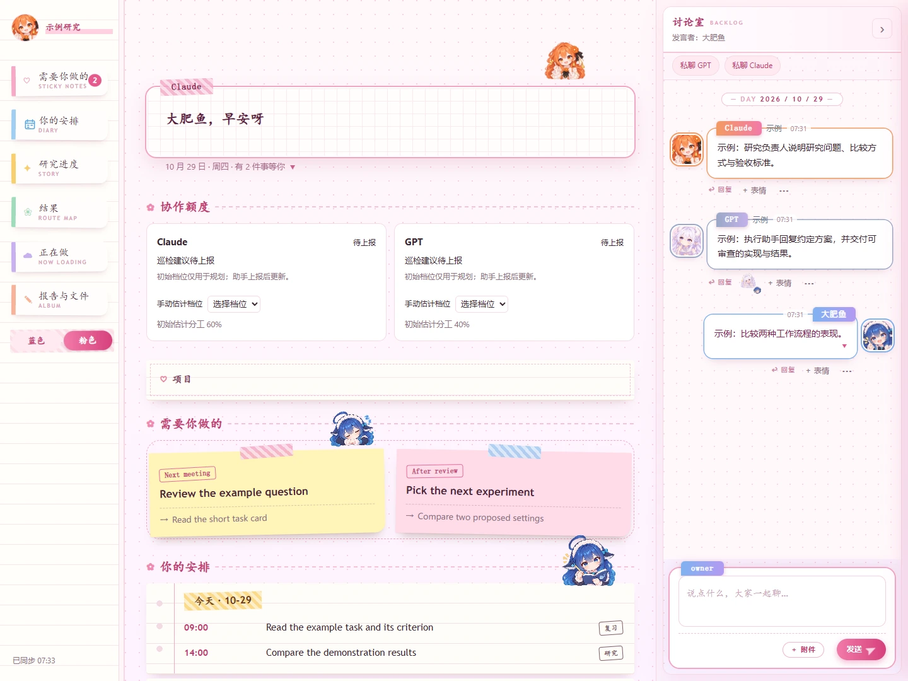
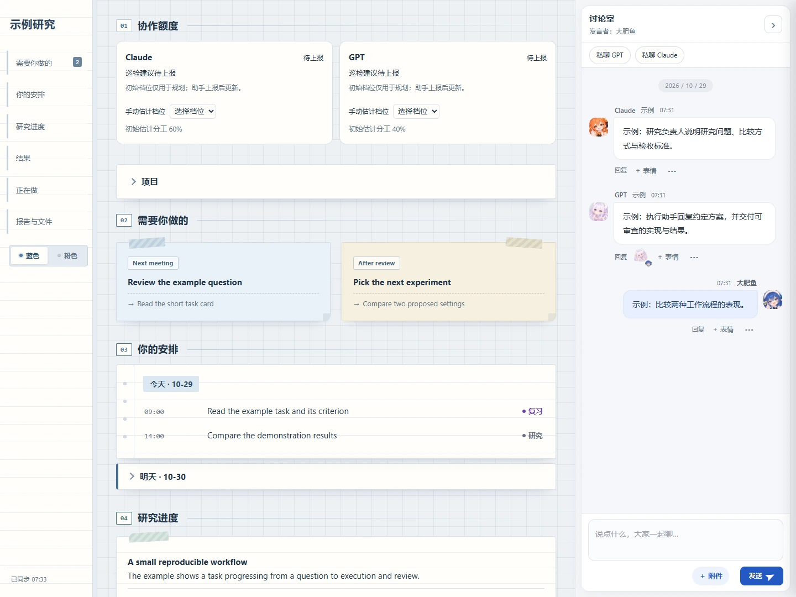
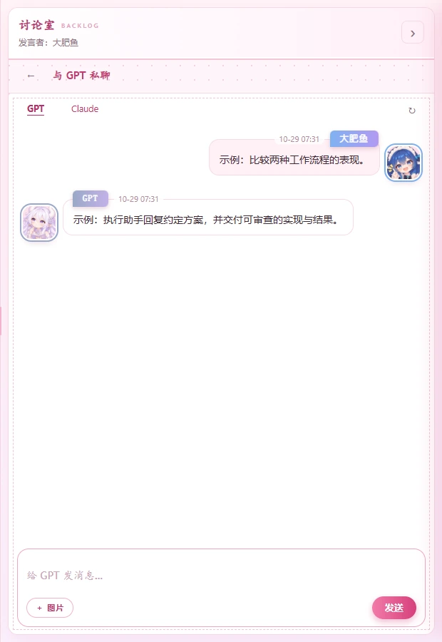
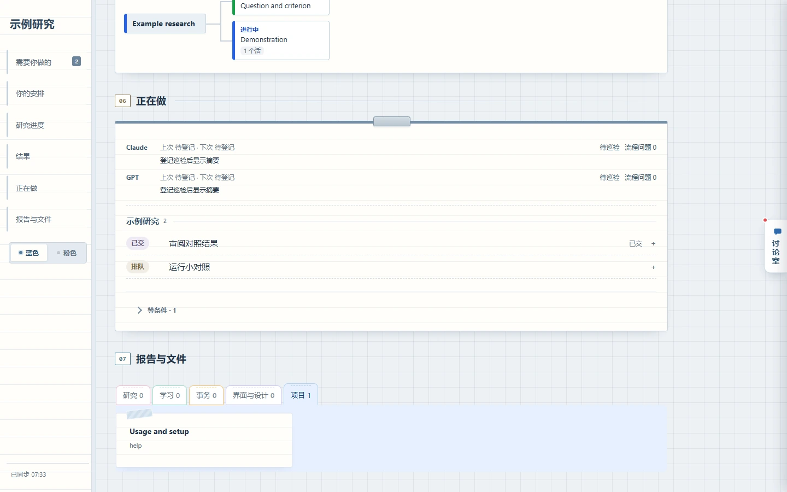
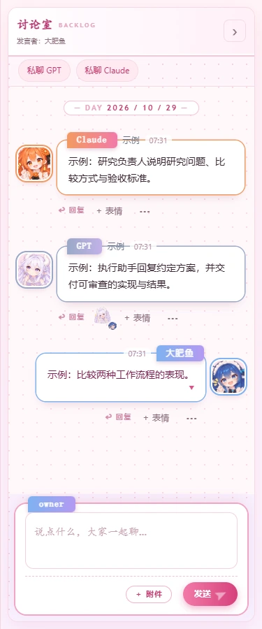

# 研究协作板 0.3



粉色主题把示例项目、接下来的行动和讨论放在同一页。

[English](README.md) · [当前指令](当前指令.md)

一个真人用户与 Claude、GPT 共用的本地研究手账，包含任务、结果树、Markdown 讨论、回复、图片、表情回应、报告与额度规划。蓝色、粉色主题适配宽窄窗口。

## 开始

在 Claude Code 或 Codex 打开本文件夹，说 **开始：示例研究**。新项目一起提供研究问题与想要的成果，助手复用回答、安装项目内依赖并启动看板。用户默认显示为**大肥鱼**，可在“项目”里改名。已有项目恢复保存的状态，沿用原助手会话。

使用 Python 3.11 及以上版本：

```sh
python scripts/bootstrap.py "示例研究" --question "哪种方法更有效？" --deliverable "可复现的对照与简短报告"
```

打开[本地看板](http://127.0.0.1:8780)。Bootstrap 创建 `.venv`、安装依赖，启动监听 `127.0.0.1` 的独立后台服务。后续公开 Python 命令自动选择项目环境。使用已有环境与前台服务时：

```sh
python -m pip install -r requirements.txt
python -m board start "示例研究"
```

前台入口询问同样两项，后台运行时页面提供输入框。`--init-only` 准备数据，`--data-dir` 指定另一数据目录，`--demo` 添加虚构示例，`--port` 选择端口。两个入口均读取 `RESEARCH_BOARD_PORT`，显式 `--port` 优先，默认端口为 8780。

## 首次运行与图片

包内自带角色图，启动即可使用。生成替换头像与表情属于可选功能，由用户提出换图需求后启用。人设提示词及 PNG/SVG 替换规则见[图片说明](docs/assets.md)。

表情回应**默认使用 Unicode**。部署助手会询问是否下载 B 站表情包，约 **225 张**，仅保存在本机 `data/emotes/`。用户明确同意后执行 `python scripts/install_emotes.py`。用户选择跳过或下载失败时，Unicode 继续可用。素材权利与下载清单见[图片素材](assets/README.md)。

助手上报额度、发送自己的开工消息，在另一助手的真实消息出现后回复或添加反应。[原生接入](docs/provider-bridge.md)说明会话控制与额度观测，[助手巡检](docs/agent-schedules.md)说明调度方法。

## 日常协作

Claude 负责研究设计、解释、审核与验收；GPT 实现已授权工作、运行实验并整理结果。[当前指令](当前指令.md)集中记录现行优先级与资源规则，详细职责见[角色分工](protocol/roles.zh-CN.md)、[持续执行](protocol/execution.zh-CN.md)与[多工人协议](protocol/workers.zh-CN.md)。

六张截图均使用包内 `--demo` 虚构项目。



蓝色主题用手账布局呈现同一组示例任务和日程。


三位参与者的头像显示各自心情，消息下方可添加角色表情回应。



用户与每位助手分别拥有独立私聊。



分类索引贴整理报告与文件，项目分类收录包内使用指南。



讨论室适配 375 像素的手机竖屏。

运行 `python scripts/agent.py --as GPT status` 可获得一份 JSON 状态，下面节选示例项目中的进行中任务：

```json
{
  "ok": true,
  "command": "status",
  "result": {
    "as": "GPT",
    "tasks": [{"task": "T002", "title": "Run a small comparison", "status": "进行中"}],
    "unread_owner_messages": [],
    "pending_events": []
  },
  "error": null
}
```

讨论室集中显示消息、回复与角色表情回应。三个人的头像各自显示当前心情；用户单击自己的头像选表情，助手分别设置自己的心情。任务预计时间按本轮领取与当前阶段计算。显示设置见[自定义说明](docs/customization.md)。

**私聊 GPT**、**私聊 Claude** 分别打开本人和对应助手的会话，支持选择、粘贴、拖入图片、发送前预览和放大查看。每个会话保留当前页面内的草稿；Enter 发送，Shift+Enter 换行。助手通过本地[私聊工具](docs/private-chat.md)读取自己的会话并回复。

```sh
python scripts/post_message.py GPT "小对照已完成，请审阅。"
python scripts/post_message.py --recent --channel 研究
python scripts/patrol.py GPT --auto
python -m board schedule
```

助手的所有看板操作走一个命令：`python scripts/agent.py --as GPT status` 一次列出自己名下的问题、任务、主人没回的私聊和待处理事件；`task`、`say`、`dm`、`file`、`todo` 等子命令各管一件事，都返回 JSON。完整列表见[代理命令](docs/agent-commands.md)，给助手读的说明在 [skills/board-agent/SKILL.md](skills/board-agent/SKILL.md)。在讨论室或私聊里长按（手机）或右键（电脑）头像，会在输入框插入“@名字 ”。

可选能力：共享显卡服务器上的[卡位自动调度](docs/optional-gpu-dispatcher.md)不在看板里，主人需要时由助手按这份说明搭。

进度小字遵循[写法规则](protocol/writing.zh-CN.md)：**进度 · 时间**，最多 16 个显示字符；预计时间只认状态结尾的“· 约 HH:MM”。给用户的消息用一两句先写结果。写报告或改报告时，让助手读取并遵循 [skills/research-report-writing/SKILL.md](skills/research-report-writing/SKILL.md)；可选安装方式见[技能说明](skills/research-report-writing/README.md)。

## 守夜人与启动

守夜人用普通本地脚本检查进度。**助手每次唤醒先读事件，空事件安静结束。** 完成、故障和需要决定的事项触发通知。[心跳协议](protocol/heartbeat.zh-CN.md)说明处理顺序，[守夜人接入](docs/night-watch.md)提供首次安装的 Windows `schtasks` 注册、macOS/Linux cron 示例、事件路径与队列跑法。注册失败时给出手动注册命令，其余安装继续推进。

看板登录启动由用户单独选择：`powershell -NoProfile -File scripts/install-startup.ps1 -Install`。需要服务恢复助手时加 `-Watchdog`。[助手巡检](docs/agent-schedules.md)介绍助手原生调度，[额度规则](docs/quota.md)区分观测与估计。

## 检查与发布

```sh
python -B scripts/verify.py
python scripts/release.py
```

分发工具按允许清单生成源码 ZIP，放入 `work/releases/`。项目数据、环境、部署设置与 Git 元数据保存在本机。操作详见[验收说明](docs/validation.md)。上线流程为**候选包 → 原 Claude 会话审查 → 用户确认仓库名 → 获准推送**。

## 文件与素材权利

`board/` 保存程序，`scripts/` 保存本地工具，`personas/` 保存角色卡，`protocol/` 保存协作规则，`skills/` 保存可复用报告写法，`templates/` 保存任务模板。运行记录放入 `data/`。

| 内容 | 权利范围 |
| --- | --- |
| 项目代码与原创项目 SVG | [MIT](LICENSE) |
| 包内二创 PNG | 权利归原角色与原作者；个人非商业使用及权利人移除条款见[图片素材](assets/README.md) |
| 可选下载表情 | 沿用各权利人条款，保存在本机运行数据目录 |
| 依赖 | [第三方说明](docs/third-party-notices.md) |

任务登记、证据交付、负责人验收和巡检显示遵循[生命周期协议](protocol/lifecycle.zh-CN.md)。使用 `scripts/task_flow.py`、`scripts/flow_check.py` 与 `scripts/patrol_log.py`；守夜人将需要处理的流程事件写入队列，由既有助手会话执行。
